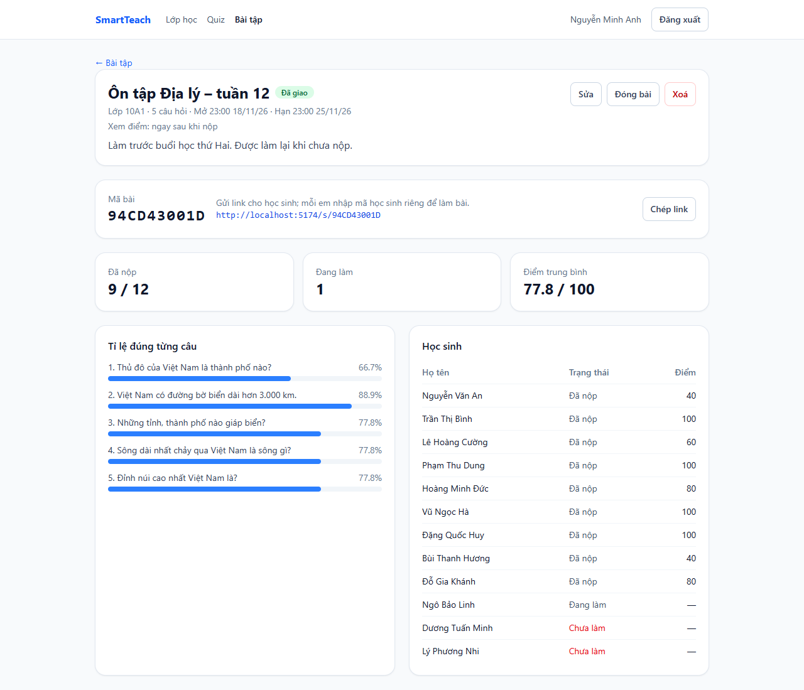
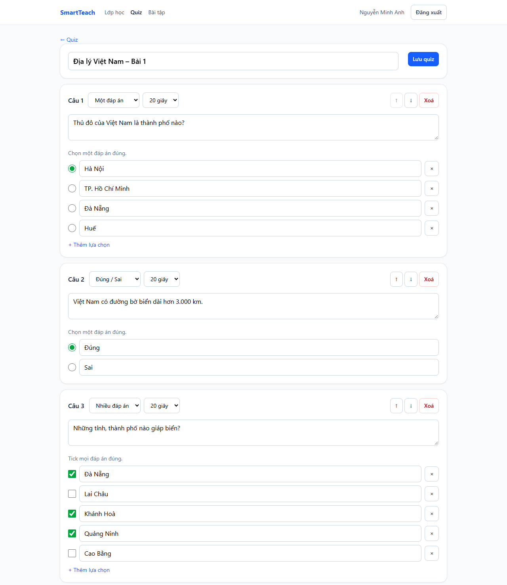
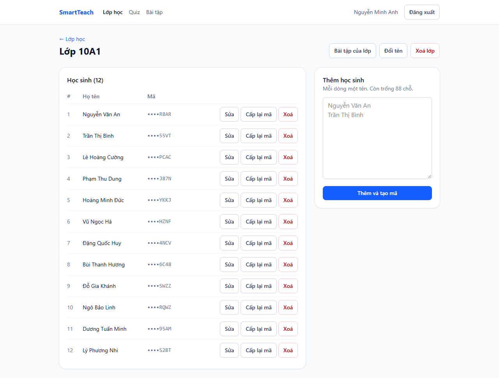
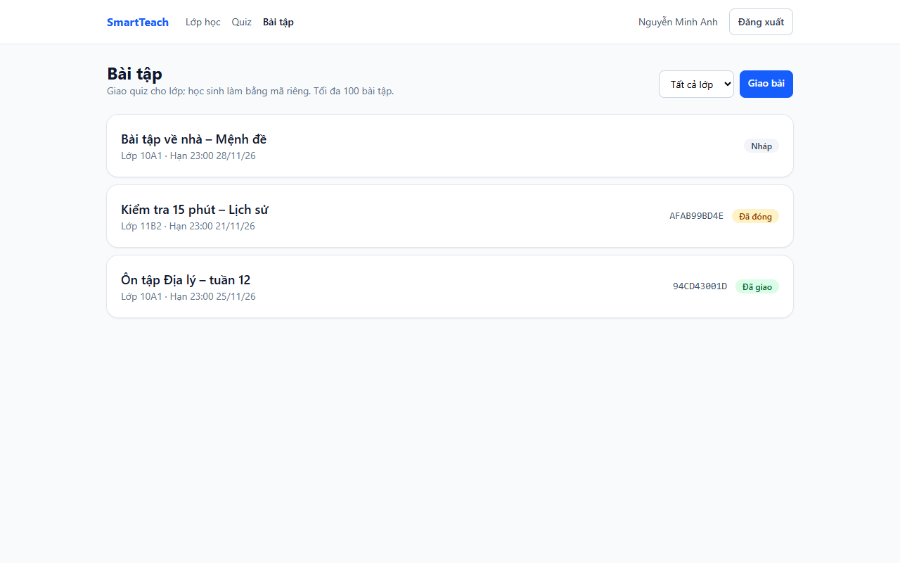
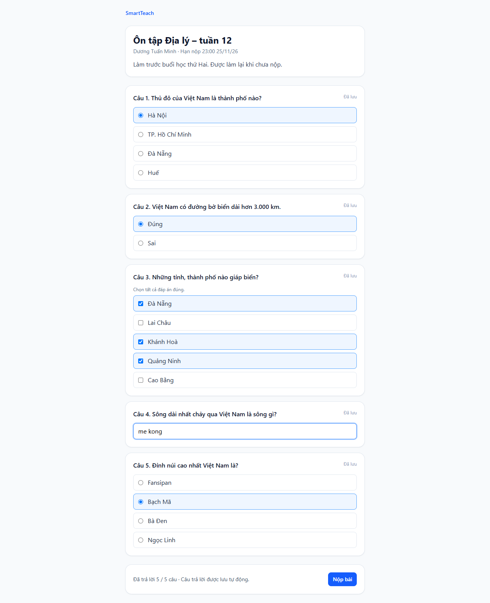
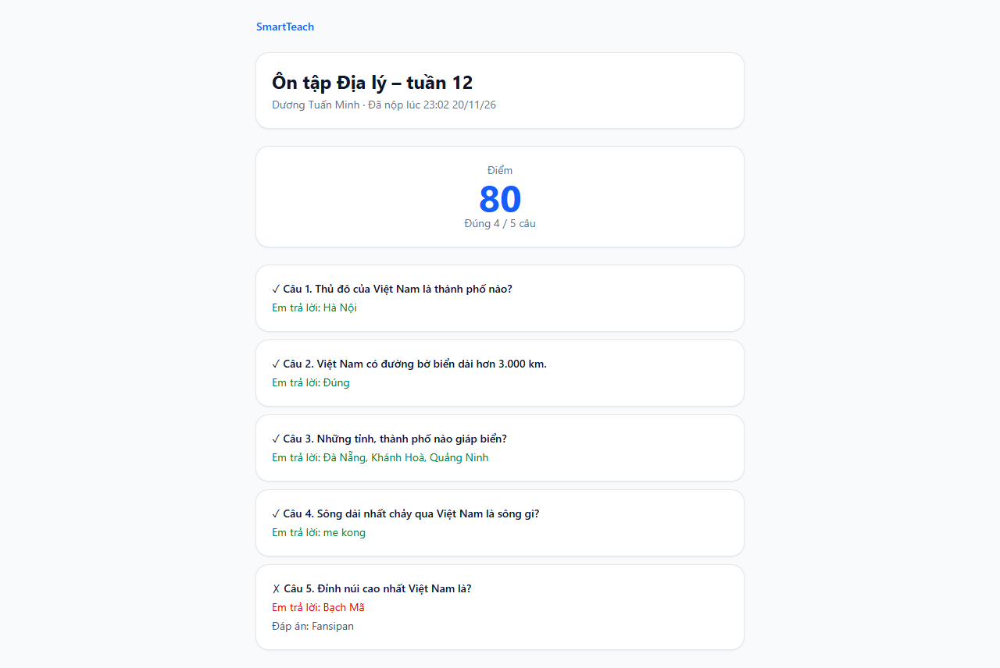
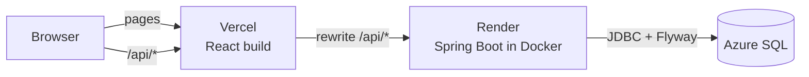

# SmartTeach

[](https://github.com/thanhsu263/smart-teach-vn/actions/workflows/ci.yml)

SmartTeach helps Vietnamese high-school teachers manage classes, build quizzes and give them
to a class as assignments. Students do not need an account: each one gets a personal access
code, opens the link the teacher shares, answers (autosaved) and gets graded on the server.
The teacher sees the average score, the correct rate of every question and who has not
started yet.

It is a portfolio project for a Java backend internship: a Spring Boot REST API with JWT
auth, SQL Server + Flyway, integration tests on a real database (Testcontainers) and a React
frontend. The UI is in Vietnamese; code, API and docs are in English.

**Live demo:** _link added after deploy_ · **API docs:** `<backend URL>/swagger-ui.html`

Demo teacher account: `demo@smartteach.vn` / _password added after deploy_. The demo
data is recreated every time the backend starts, so feel free to change anything.

> The demo runs on free plans: the first request after a quiet period can take about a
> minute while the backend and the database wake up.

## Screenshots

| Assignment analytics | Quiz editor |
|---|---|
|  |  |

| Class and student codes | Assignments |
|---|---|
|  |  |

| Student answering | Student result |
|---|---|
|  |  |

## Features

- **Auth:** register / login, 15-minute JWT access token, rotating refresh token in an
  `HttpOnly` cookie with reuse detection, roles `TEACHER` / `ADMIN`.
- **Classes and students:** add many students at once; each gets a one-time-shown access code.
- **Quizzes:** four question kinds (single, multiple, true/false, short text with
  accent-insensitive matching), validated per kind, duplicate a quiz.
- **Assignments:** publish freezes a snapshot of the quiz, students take it with their code,
  answers autosave, grading happens on the server, results are revealed immediately or after
  closing, per-question analytics.
- **Data retention:** a nightly job deletes student attempts older than 90 days.

## Tech stack

- **Backend:** Java 26, Spring Boot 4.1 (Web MVC, Security, OAuth2 Resource Server for JWT,
  Data JPA, Validation, Actuator), Flyway, MapStruct, Lombok, springdoc-openapi
- **Database:** Microsoft SQL Server 2022 (Azure SQL in production)
- **Tests:** JUnit 5, Mockito, Testcontainers (real SQL Server), JaCoCo
- **Frontend:** React + Vite + TypeScript, React Router, TanStack Query, Tailwind CSS,
  react-hook-form + zod, axios
- **CI / deploy:** GitHub Actions, Docker, Render (backend), Vercel (frontend)

## Architecture



Vercel serves the frontend and forwards `/api/*` to the backend, so the browser talks to one
site. The refresh cookie is then a first-party cookie and works with `SameSite=Lax`, even in
browsers that block third-party cookies.

The backend is split by feature (`auth`, `user`, `classroom`, `quiz`, `assignment`, `common`),
each with `controller / service / repository / entity / dto / mapper`. The database schema and
its rules are described in [docs/erd.md](docs/erd.md).

## Run locally

Requirements: Docker. For development also JDK 26 and Node 24.

```bash
git clone https://github.com/thanhsu263/smart-teach-vn.git
cd smart-teach-vn
cp .env.example .env              # then change the passwords, JWT_SECRET and DEMO_PASSWORD
```

### Option A: backend in Docker, with demo data

```bash
docker compose --profile app up -d --build   # SQL Server + backend (demo profile)
curl http://localhost:8080/actuator/health   # {"status":"UP",...}

cd frontend
npm install
npm run dev                                  # http://localhost:5173
```

Sign in with `DEMO_EMAIL` / `DEMO_PASSWORD` from your `.env`. The first build downloads the
Maven dependencies and takes a few minutes.

### Option B: backend from source (for development)

```bash
docker compose up -d              # only SQL Server on localhost:14333 + creates the database

cd backend
./mvnw spring-boot:run            # Flyway applies migrations on startup

cd ../frontend
npm install
npm run dev                       # http://localhost:5173
```

Register a new teacher in the UI, or run the backend with demo data:
`SPRING_PROFILES_ACTIVE=demo ./mvnw spring-boot:run`.

The backend reads `../.env` automatically, so no extra environment setup is needed when
running from `backend/`. In dev the Vite server proxies `/api` to the backend port from
`.env` (`SERVER_PORT`), so the browser only talks to one origin.

API docs (Swagger UI): http://localhost:8080/swagger-ui.html

### Environment variables

| Variable | Used by | Description |
|---|---|---|
| `MSSQL_SA_PASSWORD` | docker compose | SQL Server `sa` password |
| `DB_PORT` | both | Host port of SQL Server (default `14333`) |
| `DB_URL` | backend | Full JDBC URL; overrides the local default (cloud deploys) |
| `DB_USERNAME`, `DB_PASSWORD` | backend | Database credentials |
| `SERVER_PORT` | backend, Vite proxy | Backend port (default `8080`; `PORT` is used too, as set by Render) |
| `JWT_SECRET` | backend | HS256 key, **at least 32 bytes** (`openssl rand -base64 48`); the app refuses to start without it |
| `CORS_ALLOWED_ORIGINS` | backend | Comma-separated frontend origins (default `http://localhost:5173`) |
| `AUTH_COOKIE_SECURE` | backend | `true` in production (HTTPS) |
| `AUTH_COOKIE_SAME_SITE` | backend | `Lax` by default; `None` when frontend and backend are on different sites |
| `SPRING_PROFILES_ACTIVE` | backend | `demo` recreates the demo teacher and their data on every start |
| `DEMO_EMAIL`, `DEMO_PASSWORD` | backend (demo profile) | Demo teacher account; the password must have at least 8 characters |
| `VITE_API_URL` | frontend build | Backend origin; leave empty when `/api` is proxied (dev server, Vercel) |

## Deploy

The repository contains the configuration for a free deployment:

- **Database – Azure SQL Database** (free offer). Create a server and a database named
  `smartteach`, then allow the backend's outbound IP addresses in the server firewall.
  Flyway creates the schema on the first start.
- **Backend – Render** with [`render.yaml`](render.yaml) (Dashboard → New → Blueprint). It
  builds [`backend/Dockerfile`](backend/Dockerfile): a multi-stage build (JDK 26 + Maven →
  JRE 26), running as a non-root user with the heap sized for a 512 MB container. Render
  asks for the secret values (`DB_URL`, `DB_USERNAME`, `DB_PASSWORD`, `CORS_ALLOWED_ORIGINS`,
  `DEMO_PASSWORD`) and generates `JWT_SECRET`. The health check is
  `/actuator/health/liveness`, which does not depend on the database.
- **Frontend – Vercel** with root directory `frontend`.
  [`frontend/vercel.json`](frontend/vercel.json) rewrites `/api/*` to the Render URL and every
  other path to `index.html` (client-side routing). Set `CORS_ALLOWED_ORIGINS` on Render to
  the Vercel URL.

## Authentication

Teachers sign up and sign in with email + password (BCrypt). Public sign-up always creates a
`TEACHER`; `ADMIN` accounts are created directly in the database.

| Endpoint | Description |
|---|---|
| `POST /api/auth/register` | Create an account and sign in (201) |
| `POST /api/auth/login` | Sign in (401 with the same message for unknown email and wrong password) |
| `POST /api/auth/refresh` | Rotate the refresh token, return a new access token |
| `POST /api/auth/logout` | Revoke the refresh token and clear the cookie (204) |
| `GET /api/me` | Current user (needs `Authorization: Bearer <access token>`) |

How it works:

- **Access token:** a JWT signed with HS256, valid for 15 minutes, returned in the response
  body. `sub` is the user id, the `role` claim becomes `ROLE_TEACHER` / `ROLE_ADMIN`. The
  frontend keeps it in memory only.
- **Refresh token:** 32 random bytes sent as an `HttpOnly` cookie limited to `/api/auth`,
  valid for 14 days. Only its SHA-256 hash is stored in `refresh_tokens`.
- **Rotation and reuse detection:** every refresh revokes the presented token and issues a
  new one in the same *family*. If a token that was already revoked is presented again, it
  was stolen or replayed, so the whole family is revoked and the user must sign in again.
  The revoke is a conditional `UPDATE … WHERE revoked_at IS NULL`, so two parallel refreshes
  with the same token cannot both succeed.
- **Frontend:** an axios interceptor catches `401`, calls `/api/auth/refresh` once (parallel
  requests share the same call) and retries the original request. On page load the session
  is restored from the refresh cookie.
- **Errors:** every error is an RFC 9457 `ProblemDetail`; validation errors include an
  `errors` map (field → message).

## Classes and students

A teacher can have up to 20 classes and each class up to 100 students. Students have no
account: each one gets a personal **access code** (10 characters, e.g. `858PXU7TJ3`) that they
will use to open assignments.

| Endpoint | Description |
|---|---|
| `GET /api/classes?page=0&size=20` | My classes with student counts, newest first (max page size 100) |
| `POST /api/classes` | Create a class |
| `GET` / `PUT` / `DELETE /api/classes/{id}` | Read, rename, delete (students, assignments and results go with it) |
| `GET /api/classes/{id}/students` | Students in order, with the code hint only |
| `POST /api/classes/{id}/students` | Add many students at once: `{"names": ["An", "Bình"]}` → their codes |
| `PUT` / `DELETE /api/students/{id}` | Rename or remove a student |
| `POST /api/students/{id}/access-code` | Replace a student's code (the old one stops working) |

Design notes:

- **Ownership:** there is no row-level security in SQL Server here, so every query filters by
  `owner_id = current user`. Another teacher's class or student returns **404**, not 403, so
  ids of other teachers' data cannot be probed.
- **Access codes are shown once.** Only a SHA-256 hash and the last 4 characters (`code_hint`)
  are stored. SHA-256 instead of BCrypt because a code must be found by its hash in one
  indexed lookup; this is safe because codes are random (about 49 bits from an alphabet without
  look-alike characters such as `0/O`, `1/I/L`), not passwords chosen by people.
- **Bulk add** locks the class row (`PESSIMISTIC_WRITE`), so the 100-student limit and the
  positions stay correct when two requests arrive together.
- **Deletes:** SQL Server does not allow two cascade paths to `attempts`, so deleting a class
  relies on `ON DELETE CASCADE` through assignments, and deleting a student first deletes that
  student's attempts in the same transaction.

## Quizzes

A quiz is one aggregate: quiz → questions → options / accepted answers. A teacher can have up to
50 quizzes, each with up to 50 questions.

| Kind | Rules |
|---|---|
| `single` | 2–6 options, exactly one correct |
| `multi` | 2–6 options, at least one correct |
| `true_false` | exactly 2 options, exactly one correct |
| `short_text` | no options, 1–10 accepted answers; `ignoreDiacritics` makes "Ha Noi" match "Hà Nội" |

Every question has a time limit of 10, 20, 30, 60 or 90 seconds (default 20). Option labels and
accepted answers must be different from each other (ignoring case and surrounding spaces).

| Endpoint | Description |
|---|---|
| `GET /api/quizzes?page=0&size=20` | My quizzes with question counts, last edited first |
| `POST /api/quizzes` | Create a quiz with its questions |
| `GET` / `PUT` / `DELETE /api/quizzes/{id}` | Read, replace, delete |
| `POST /api/quizzes/{id}/duplicate` | Copy a quiz; the title gets the suffix `(bản sao)` |

Design notes:

- **Save = replace.** `PUT` sends the whole quiz. The service locks the quiz row, deletes its
  questions in one statement (options and answers go with them by `ON DELETE CASCADE`) and
  inserts the new list. This is simpler than diffing questions, and positions always stay
  0, 1, 2… without gaps.
- **No N+1.** Reading a quiz takes exactly 3 queries however many questions it has: the quiz,
  questions with their options (`left join fetch`), then the accepted answers. Two collections
  are not fetched in one query because that multiplies rows (and Hibernate rejects two bags).
  An integration test counts the statements with Hibernate statistics.
- **Validation in two layers.** Bean Validation checks field sizes; `QuizRules` checks the rules
  per kind and returns every error with its path, e.g. `questions[1].options`, so the editor can
  show it next to the right question.
- **Deleting a quiz keeps assignments.** An assignment stores a JSON snapshot of the quiz when
  it is published, so deleting the quiz only clears `assignments.quiz_id`.

## Assignments

A teacher gives a quiz to a class as an assignment (up to 100 assignments per teacher). Its
status goes `draft` → `published` → `closed`.

| Endpoint | Description |
|---|---|
| `GET /api/assignments?classId=&page=0&size=20` | My assignments, optionally for one class |
| `POST /api/assignments` | Create a draft: class, quiz, title, description, `opensAt`, `dueAt`, `revealPolicy` |
| `GET` / `PUT` / `DELETE /api/assignments/{id}` | Read, edit, delete (attempts go with it) |
| `POST /api/assignments/{id}/publish` | Freeze the quiz into a snapshot and open the assignment |
| `POST /api/assignments/{id}/close` | Close early; students can no longer save or submit |
| `GET /api/assignments/{id}/analytics` | Average score, correct rate per question, every student's status |

Students use the public endpoints, without an account:

| Endpoint | Description |
|---|---|
| `POST /api/public/assignments/{code}/start` | `{"accessCode": "..."}` → attempt token + questions (no answers) |
| `GET /api/public/attempts/{id}` | The attempt with the answers saved so far |
| `PUT /api/public/attempts/{id}/answers/{position}` | Save one answer (autosave) |
| `POST /api/public/attempts/{id}/submit` | Grade on the server and return the result |
| `GET /api/public/attempts/{id}/result` | Score and correct answers, when the reveal policy allows |

Every `/attempts` call sends the token in the `X-Attempt-Token` header.

Student flow in the UI: the teacher copies the link `/s/{code}` from the assignment page; the
student opens it, types their personal access code, answers (each answer is saved as they go)
and submits. With `revealPolicy = immediate` they see the score and correct answers right away;
with `after_close` only after the due date or when the teacher closes the assignment.

Design notes:

- **Snapshot on publish.** Publishing copies the quiz into `assignments.quiz_snapshot` (JSON).
  Editing or deleting the quiz later does not change an assignment students are already taking,
  and grading always uses the snapshot. After publishing, class and quiz cannot be changed.
- **One attempt per student.** A filtered unique index on `(assignment_id, student_id) WHERE
  status = 'in_progress'` makes two parallel "start" requests unable to create two attempts.
  Starting again (e.g. on another device) reuses the attempt with a new token.
- **Attempt tokens** are random; only their SHA-256 hash is stored. A wrong assignment code,
  student code, attempt id or token always gives the same **404**, so none can be probed.
  When the teacher replaces a student's access code, the attempt in progress is invalidated.
- **Grading on the server only.** Students never receive `isCorrect` or accepted answers before
  submitting. `multi` needs exactly the correct set. `short_text` ignores case and extra spaces;
  with `ignoreDiacritics` it also removes accents (`java.text.Normalizer` + `đ → d`). Score =
  correct / total × 100, rounded to a whole number. Submitting twice returns the first result.
- **Time rules.** `dueAt` must be after `opensAt`. Saving or submitting before `opensAt`, after
  `dueAt` or after closing returns **409**.
- **Retention.** `AttemptRetentionJob` runs every night at 03:00 UTC and deletes attempts (and
  their answers) started more than 90 days ago. The cron can be changed with `app.retention.cron`.

## Tests

```bash
cd backend && ./mvnw verify       # needs Docker running (Testcontainers)
cd frontend && npm run lint && npm run build
```

Integration tests start one SQL Server container and share a single Spring context. Auth tests
cover wrong password, expired and tampered tokens, refresh-token rotation and reuse, logout,
validation errors and role-protected endpoints (401 / 403 / 200). Class tests cover the full
CRUD flow, "another teacher gets 404" on every endpoint, one-time codes and stored hashes,
validation, the 20-class / 100-student limits and cascading deletes with existing attempts.
Quiz tests cover the rules of each question kind (unit tests), the save-replace order and limits
(Mockito), and over HTTP: CRUD with all four kinds, duplicate, 404 for another teacher, error
paths, the 3-query read and deleting a quiz that an assignment still points to.
Assignment tests cover grading for every kind (unit tests), the publish and schedule rules
(Mockito), and over HTTP the full flow publish → start → autosave → submit → analytics, hidden
answers before submitting, both reveal policies, 404 for wrong codes and tokens, invalidation
after a new access code, and the 90-day retention job. A demo-data test checks that the seed
builds the expected classes, quizzes and results and can run twice.

The JaCoCo report is written to `backend/target/site/jacoco/index.html`. `mvn verify` fails if
line coverage of any `service` package drops below 70%.
