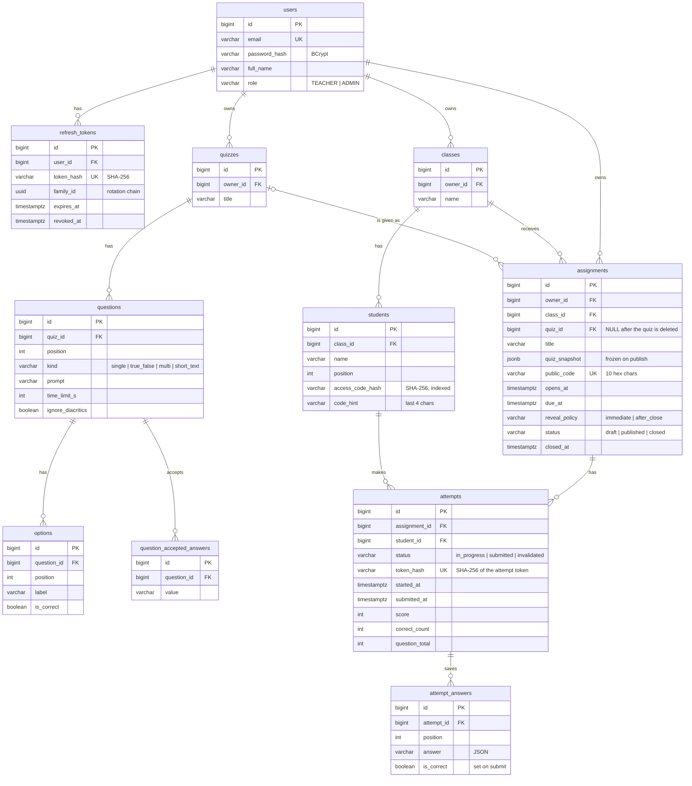

# Database (ERD)

PostgreSQL 18, created by Flyway (`backend/src/main/resources/db/migration`). Text columns are
`VARCHAR` (UTF-8), times are `TIMESTAMPTZ` and the quiz snapshot is `JSONB`. Audit columns (`created_at`, `updated_at`) are left out
of the diagram.

Rules enforced by the database:

- `users`: unique index on `lower(email)`, so two emails that differ only in case cannot both
  be registered (the service also lower-cases emails before saving them).
- `attempts`: partial unique index on `(assignment_id, student_id) WHERE status = 'in_progress'`,
  so one student cannot have two attempts in progress for the same assignment, even when two
  "start" requests arrive at the same time.
- CHECK constraints for every enum column, text lengths, `due_at > opens_at`, the `public_code`
  format (`^[0-9A-F]{10}$`), a snapshot once published and
  "`closed_at` is set only when the status is `closed`" (same idea for `submitted_at`).
- Deletes cascade: deleting a class removes its students, assignments and their attempts;
  deleting a student removes that student's attempts; deleting a quiz keeps the assignments made
  from it (`quiz_id` becomes `NULL`, the snapshot stays).
- PostgreSQL does not index foreign keys by itself, so every foreign key used in a lookup or a
  cascade has its own index.
