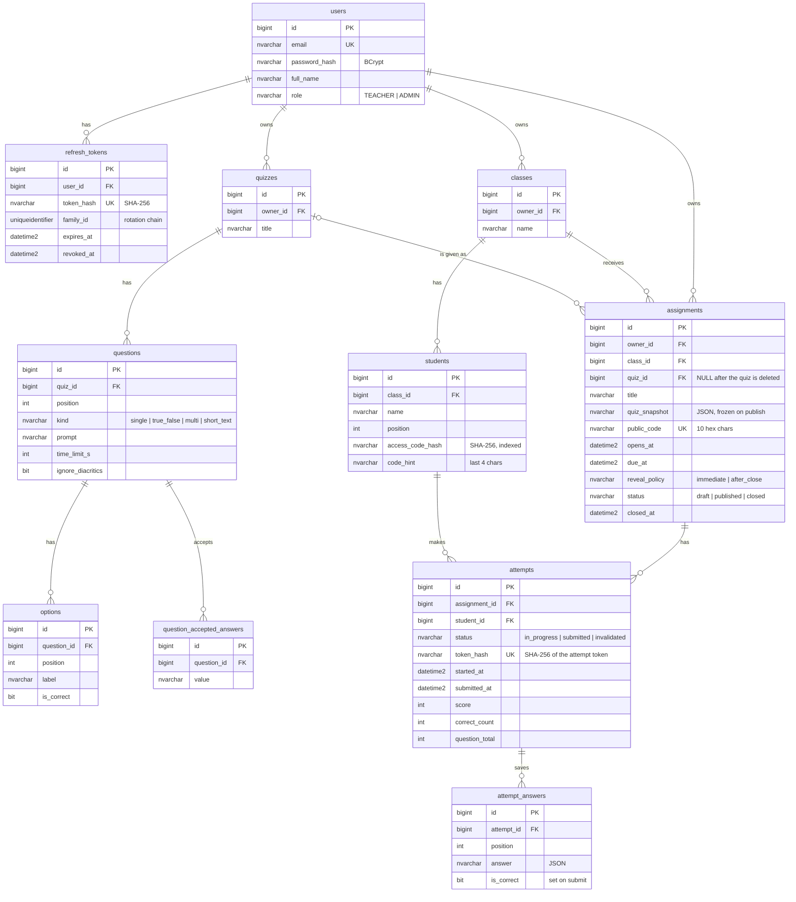

# Database (ERD)

SQL Server, created by Flyway (`backend/src/main/resources/db/migration`). Text columns are
`NVARCHAR`, times are `DATETIME2` in UTC. Audit columns (`created_at`, `updated_at`) are left out
of the diagram.

Rules enforced by the database:

- `attempts`: filtered unique index on `(assignment_id, student_id) WHERE status = 'in_progress'`,
  so one student cannot have two attempts in progress for the same assignment.
- CHECK constraints for every enum column, text lengths, `due_at > opens_at`, the `public_code`
  format, a valid JSON snapshot once published and
  "`closed_at` is set only when the status is `closed`" (same idea for `submitted_at`).
- SQL Server allows only one cascade path to a table. Deleting a class cascades to its
  assignments and their attempts; deleting a student removes that student's attempts in the
  service first.
